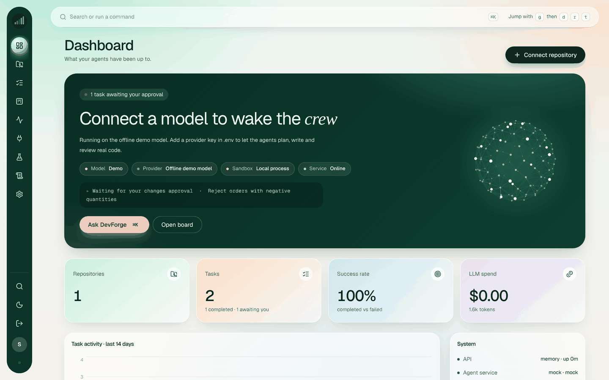
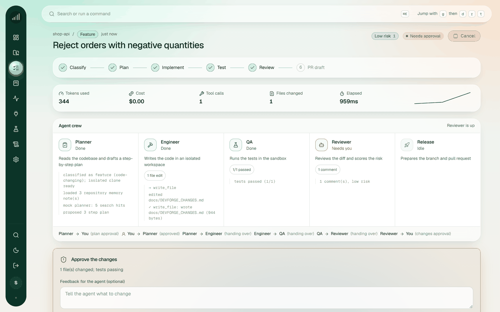
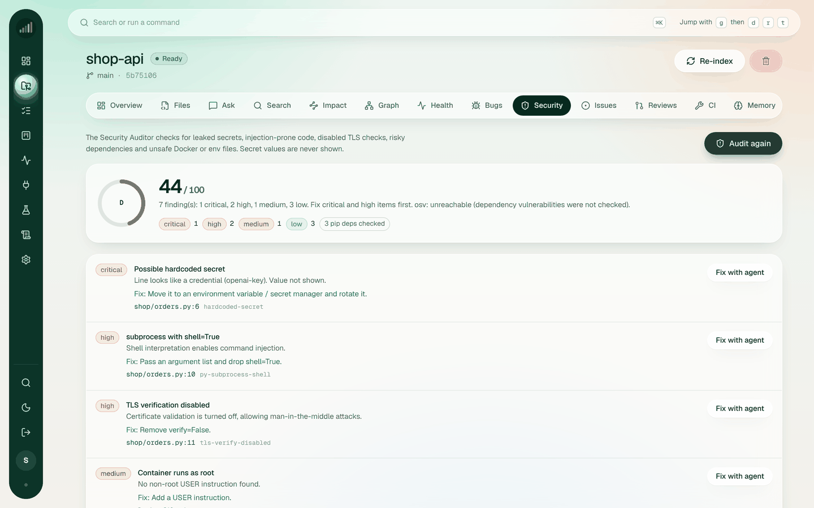
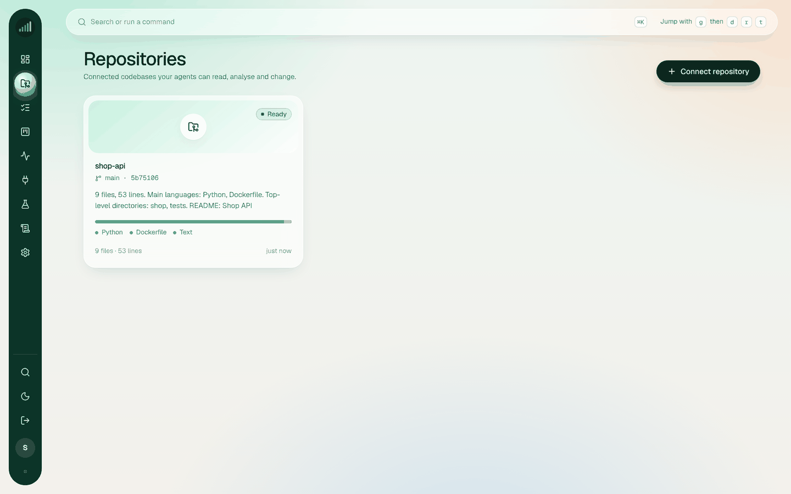
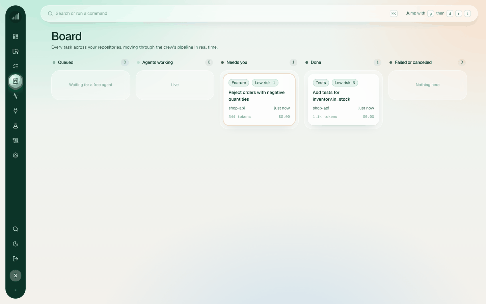
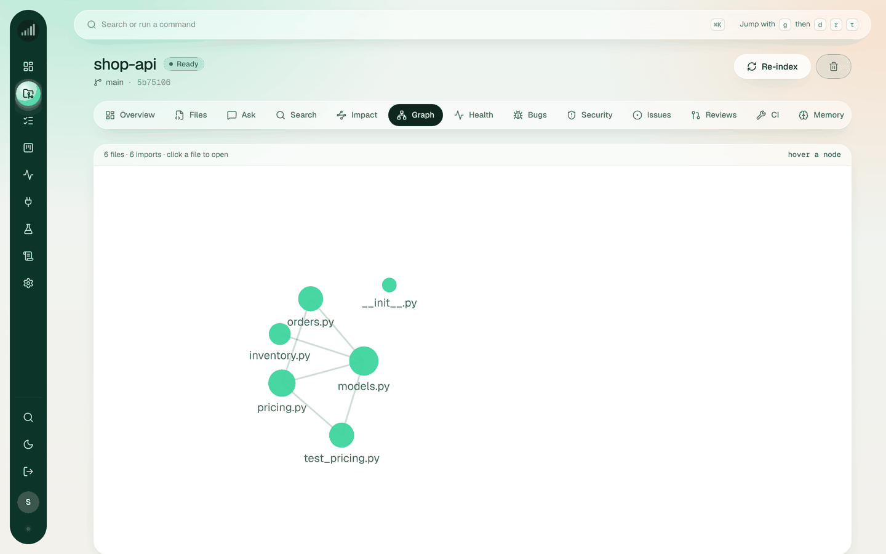
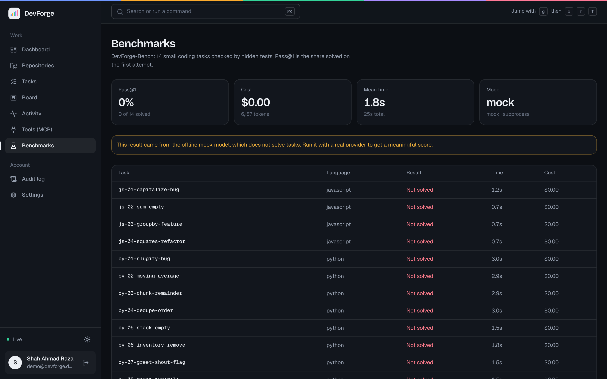

<div align="center">

# DevForge

**An AI engineering crew for your GitHub repositories.**

Connect a repo. DevForge indexes it, answers questions with file citations, audits it for security problems,
and runs agent tasks that plan, code, test and review changes. You approve the plan and the final diff before anything is pushed.

[](https://github.com/ahmad2techmaestro/devforge/actions/workflows/ci.yml)


</div>



## Contents

- [Features](#features)
- [Screenshots](#screenshots)
- [How it works](#how-it-works)
- [Quick start](#quick-start)
- [Connect a real model](#connect-a-real-model)
- [Optional integrations](#optional-integrations)
- [Deploying](#deploying)
- [Testing](#testing)
- [Project layout](#project-layout)
- [Design decisions](#design-decisions)
- [Known limitations](#known-limitations)
- [Contributing and security](#contributing-and-security)
- [Author](#author)

## Features

| | |
|---|---|
| **Agent crew** | Planner, Engineer, QA, Reviewer and Release agents work one task through a LangGraph pipeline. The UI shows who is working, what they did and every handoff, live. |
| **Human approval gates** | Plans and diffs wait for your approval. You can drop plan steps, reject with feedback, or cancel. Runs resume from a checkpoint, so they survive restarts. |
| **Spec-first plans** | Every plan shows requirements (WHEN/THEN criteria), design and steps before you approve it. |
| **Repo intelligence** | Code viewer, hybrid semantic search (BM25 + embeddings + reranker), symbols, import graph, call graph, impact analysis ("what breaks if I change this file"), file explanations, and chat with citations. |
| **Security Auditor** | Finds hardcoded secrets, injection-prone code, disabled TLS checks, risky dependencies, committed `.env` files and root containers. Dependencies are checked against OSV.dev, and Semgrep runs when installed. Secret values are never shown. |
| **Issue to PR autopilot** | Pick a GitHub issue, or label it `devforge` through a signed webhook, and the crew works it. Approval gates still apply. |
| **PR review and CI autopilot** | Reviews pull requests with line-level comments, and drafts a fix task when CI fails on the default branch. |
| **Repo memory** | Notes you write, plus feedback learned when you reject a plan, are sent with every run so agents stop repeating mistakes. |
| **MCP tools** | Connect any Model Context Protocol server (GitHub, filesystem, browser, database). DevForge is also an MCP server for Claude Desktop and Cursor. |
| **Board, activity, vitals** | Kanban board of all tasks, a live activity feed, per-run tokens, cost and tool calls, and a Cmd+K palette that answers questions about your code. |
| **Benchmarks** | DevForge-Bench: 14 tasks verified by hidden tests. Run it from the UI against your own model and watch the progress live. |
| **Safe by default** | Code runs only in a sandbox. Path confinement, command denylist, encrypted tokens, rate limits, audit log, budget cap and Slack/Discord alerts. |

## Screenshots

| Tasks with approval gate | Security Auditor |
|---|---|
|  |  |
| **Repositories** | **Board** |
|  |  |
| **Import graph** | **Benchmarks** |
|  |  |

*Screenshots are generated from the running app with the offline demo model: `npm run screenshots`.*

## How it works

```
 React + Vite + TS  --REST / WebSocket-->  Express API (TS)  --HTTP-->  FastAPI agent (Python)
 (TanStack Query,                          MongoDB, Redis, BullMQ        LangGraph pipeline,
  Zustand, Tailwind)                              ^                      sandbox, LLM providers
                                                  |  sequenced events (X-Internal-Key)  |
                                                  +-------------------------------------+
```

1. The API queues a run (BullMQ) and calls the agent. The agent streams **sequenced events** back.
2. The API stores events idempotently (`runId + seq`), updates tasks and approvals, and fans them out to the browser over Redis pub/sub and WebSockets.
3. The agent pauses at `interrupt()` for approval. Approving resumes the graph from a SQLite checkpoint.
4. Code runs only inside the sandbox (Docker when available, otherwise a local process for development).

```
classify -> plan -> [your approval] -> implement -> test -+-> (fail) fix -> test
                                                          +-> review -> [your approval] -> PR draft
```

| Layer | Tech |
|---|---|
| Client | React 18, TypeScript, Vite, Tailwind, TanStack Query, Zustand, Framer Motion, Recharts, d3-force |
| Server | Node 22, Express 5, TypeScript, Zod, JWT + bcrypt, BullMQ, ioredis, ws, prom-client, pino |
| Data | MongoDB (file-backed adapter for development), Redis |
| AI service | Python 3.12+, FastAPI, LangGraph, SQLite checkpointer, Gemini / Groq / OpenAI / Anthropic / Ollama / OpenRouter / any OpenAI-compatible server |
| Ops | Docker, docker-compose, nginx, GitHub Actions |

## Quick start

**You need:** Node 22+, Python 3.12+, and Redis (or Docker, to run Redis). No API key and no MongoDB are needed to try it.

```bash
git clone https://github.com/ahmad2techmaestro/devforge.git
cd devforge
npm run setup     # installs server and client, creates the Python venv for ai-service
npm run dev       # starts Redis (if installed), ai-service :8000, server :4000, client :5173
```

Open **http://127.0.0.1:5173**, create an account and connect a repository.

If Redis is not installed, start it once with Docker (this is the easiest route on Windows):

```bash
docker run -d --name devforge-redis -p 6379:6379 redis:7-alpine
```

Without keys, DevForge runs on an offline demo model so you can click through every screen. The demo model does not solve real tasks. To get real results, [connect a model](#connect-a-real-model).

Local development uses a file-backed database in `.devdata/db.json`, so accounts survive restarts. Delete that folder to reset.

### Connecting a repository

| Tab | Use it for |
|---|---|
| **GitHub** | Repos from your account. Add a token under Settings for private repos. |
| **Clone URL** | Any public `https://` repository. |
| **Local path** | A full path on the machine that runs DevForge, for example `C:\Users\you\projects\app` or `/home/you/app`. Quotes from "Copy as path" are accepted. |

### Run with Docker

```bash
cp .env.example .env            # fill INTERNAL_KEY, JWT_SECRET, ENCRYPTION_KEY (commands are inside the file)
mkdir -p data/agent
docker compose up --build
# UI http://localhost:8080   API http://localhost:4000
```

## Connect a real model

Put the settings in the root `.env` (`npm run dev` and Docker both read it), restart, then open **Settings, Agent runtime, Test the model connection**.

| Provider | `.env` | Cost |
|---|---|---|
| Gemini | `LLM_PROVIDER=gemini` `GEMINI_API_KEY=` ([aistudio.google.com](https://aistudio.google.com)) | free tier |
| Groq | `LLM_PROVIDER=groq` `GROQ_API_KEY=` ([console.groq.com](https://console.groq.com)) | free tier |
| Ollama | `LLM_PROVIDER=ollama` `OLLAMA_MODEL=qwen2.5-coder` | free, local |
| OpenRouter | `LLM_PROVIDER=openrouter` `OPENROUTER_API_KEY=` | pay per use, has free models |
| OpenAI / Anthropic | `LLM_PROVIDER=openai` or `anthropic`, plus the key | paid |
| OpenAI-compatible server | `LLM_PROVIDER=openai_compatible` `OPENAI_BASE_URL=` | varies |

- `LLM_FAST_MODEL` sends easy steps to a cheaper model.
- `EMBEDDING_PROVIDER=auto` uses real embeddings when a key exists, otherwise an offline hash embedder.
- Plans, reviews and bug reports use the provider's JSON-schema mode where available, and every result is validated. A broken plan is repaired with one extra call instead of failing the run.
- Free-tier models are weaker than paid ones. Expect lower scores on hard tasks.

**Check your setup:** `npm run doctor` makes live calls (chat, JSON mode, tool calling, embeddings, reranker, MCP, OSV, GitHub) and prints PASS or FAIL for each layer with the fix. It never prints your keys.

**Measure your model:** open **Benchmarks** and press **Run**, or use `cd ai-service && python eval/run_bench.py`. The page only runs on a real provider and refuses the demo model.

### Sandbox

| `SANDBOX` | Behaviour |
|---|---|
| `auto` (default in `npm run dev`) | Docker when Docker is running, otherwise a local process |
| `docker` | Isolated containers (recommended for anything shared) |
| `subprocess` | Local process, **no isolation**, for development only |

Settings shows which one is active. If Docker is installed but stopped, start Docker Desktop and restart `npm run dev`.

> **Security note:** the Docker deployment mounts the Docker socket to start sandboxes, which is root-equivalent on the host. Run it on a dedicated machine. See [SECURITY.md](SECURITY.md).

## Optional integrations

<details>
<summary><b>Google and GitHub sign-in</b></summary>

Email sign-in works out of the box. A social button stays disabled until its keys are set in `.env`.

| Provider | Create it at | Callback URL |
|---|---|---|
| Google | Google Cloud Console, APIs & Services, Credentials, OAuth client ID (Web application) | `http://127.0.0.1:4000/api/auth/oauth/google/callback` |
| GitHub | GitHub, Settings, Developer settings, OAuth Apps | `http://127.0.0.1:4000/api/auth/oauth/github/callback` |

Set `GOOGLE_CLIENT_ID`, `GOOGLE_CLIENT_SECRET`, `GITHUB_OAUTH_CLIENT_ID` and `GITHUB_OAUTH_CLIENT_SECRET`, then restart. For a deployed site, use your public API URL in the callback and set `PUBLIC_API_URL` and `WEB_ORIGIN`.
</details>

<details>
<summary><b>MCP tools for agents</b></summary>

Open **Tools (MCP)** in the app, pick a preset (filesystem, GitHub, fetch, Playwright) or add your own command or URL. Environment variables and headers are encrypted. During planning, agents only get read-only tools.

Local (stdio) servers run commands on the agent host, so they are off by default. `npm run dev` enables them for your own machine. For a deployment, set `MCP_ALLOW_STDIO=true` only if you trust every user. Remote URLs on private addresses are blocked unless `MCP_ALLOW_PRIVATE=true`.

Use DevForge from Claude Desktop or Cursor (read-only, one repo per server):

```json
{
  "mcpServers": {
    "devforge": {
      "command": "python",
      "args": ["-m", "app.mcp.server", "--repo", "/path/to/repo"],
      "cwd": "/path/to/devforge/ai-service"
    }
  }
}
```
</details>

<details>
<summary><b>GitHub webhook (the <code>devforge</code> label trigger)</b></summary>

1. Set `GITHUB_WEBHOOK_SECRET` (8+ characters) and expose `POST /webhooks/github` publicly.
2. In the GitHub repo, add a webhook to `https://YOUR_API/webhooks/github` with content type `application/json`, the same secret, and the events **Issues**, **Pull requests** and **Workflow runs**.
3. Label an issue `devforge` (change it with `WEBHOOK_LABEL`). Everyone who connected that repo gets a task to approve. New or updated PRs get a review, and failed CI on the default branch drafts a fix task when `autoFixCi` is on for the repo.

Signatures (`X-Hub-Signature-256`) are verified over the raw body with a constant-time compare. Without a secret the endpoint is disabled.
</details>

## Deploying

A free demo setup: web client on Netlify, API and agent on Render, MongoDB on Atlas. The files `netlify.toml` and `render.yaml` hold the configuration.

1. **MongoDB:** create a free cluster on [MongoDB Atlas](https://www.mongodb.com/atlas), add a database user, allow access from anywhere (Render's free IPs change), and copy the connection string.
2. **Render:** New, Blueprint, pick this repository. Render asks for three values: `MONGO_URL` (step 1), `ENCRYPTION_KEY` (run `node -e "console.log(require('crypto').randomBytes(32).toString('hex'))"`), and `GEMINI_API_KEY`. Everything else, including the shared internal key and JWT secret, is generated.
3. **Netlify:** link this repository to the site. The build settings come from `netlify.toml`.
4. Open the Netlify URL, create an account and connect a repository.

The service names in `render.yaml` and `netlify.toml` decide the public URLs. If you rename them, update `AGENT_URL`, `API_PUBLIC_URL`, `OAUTH_REDIRECT_BASE`, `WEB_ORIGIN`, `CORS_ORIGINS` and `VITE_API_URL` to match.

Free tiers sleep after 15 minutes without traffic, so the first request can take about a minute. Render has no Docker daemon, so the agent runs code in a local process **without isolation** (`SANDBOX=subprocess`). Treat this deployment as a private demo: do not share the URL widely and do not connect repositories that hold secrets. For real use, run the agent on a machine with Docker and `SANDBOX=docker`.

## Testing

```bash
npm test          # ai-service, server and client suites
npm run e2e       # redis + ai-service + server: index, chat, security, memory, task, approvals, completion
npm run crawl     # real browser walk through sign-up, repo connect, a full task and every page
```

| Package | Checks |
|---|---|
| `ai-service` | 211 pytest tests, ruff |
| `server` | 49 vitest tests, tsc |
| `client` | 22 vitest tests, tsc, production build |
| `crawl` | 46 browser checks (needs Playwright's Chromium) |

CI runs all suites plus the Docker image builds (`.github/workflows/ci.yml`).

## Project layout

```
devforge/
├── client/        React + Vite + TypeScript UI
├── server/        Express API (routes, services, models, integrations, realtime)
├── ai-service/    FastAPI + LangGraph agents, sandbox, repo intelligence, security auditor, eval
├── docs/          PLAN.md, CONTRACT.md (server <-> ai-service), images/
├── scripts/       setup, dev, test-all, e2e, crawl, doctor, screenshots
├── .github/       CI workflow
└── docker-compose.yml
```

## Design decisions

- **Contract first.** `docs/CONTRACT.md` fixes the API and agent interface, so each side is tested against the same shapes.
- **Events are the source of truth.** Ordered, idempotent events make the UI replayable and the system safe against retries and restarts.
- **Swappable adapters.** The database, the sandbox and the LLM sit behind interfaces, so the whole system can be tested without external services.
- **Safety by default.** Path confinement, a command denylist, encrypted tokens passed to git by header, rate limits, an audit log and approval gates.

## Known limitations

- The test suites run against local fakes (a fake OpenAI-compatible server, GitHub and OSV) and the offline demo model. Run `npm run doctor` and **Test the model connection** first when you add real keys.
- The demo model does not solve tasks, so the benchmark scores 0/14 on it by design. Real scores need a real model.
- The Docker sandbox path is covered by unit tests, but has had less real-world use than the local process sandbox.
- Code analysis uses tree-sitter when installed, otherwise Python's AST or regex for JS/TS. It is not a full language server.
- Single-user accounts, with no teams or roles. GitHub access uses a personal token or OAuth, not a GitHub App.
- Not deployed. The CI and Docker files are ready for it.

## Contributing and security

Contributions are welcome. See [CONTRIBUTING.md](CONTRIBUTING.md). To report a vulnerability, follow [SECURITY.md](SECURITY.md) and please do not open a public issue.

## Acknowledgements

The Planner, approval, Programmer and Reviewer flow is inspired by LangChain's [Open SWE](https://github.com/langchain-ai/open-swe). DevForge is an independent implementation and contains none of its code.

## Author

**Shah Ahmad Raza** · [GitHub](https://github.com/ahmad2techmaestro) · [LinkedIn](https://www.linkedin.com/in/shah-ahmad-raza-62a72722b)

## License

Released under the [MIT License](LICENSE).
